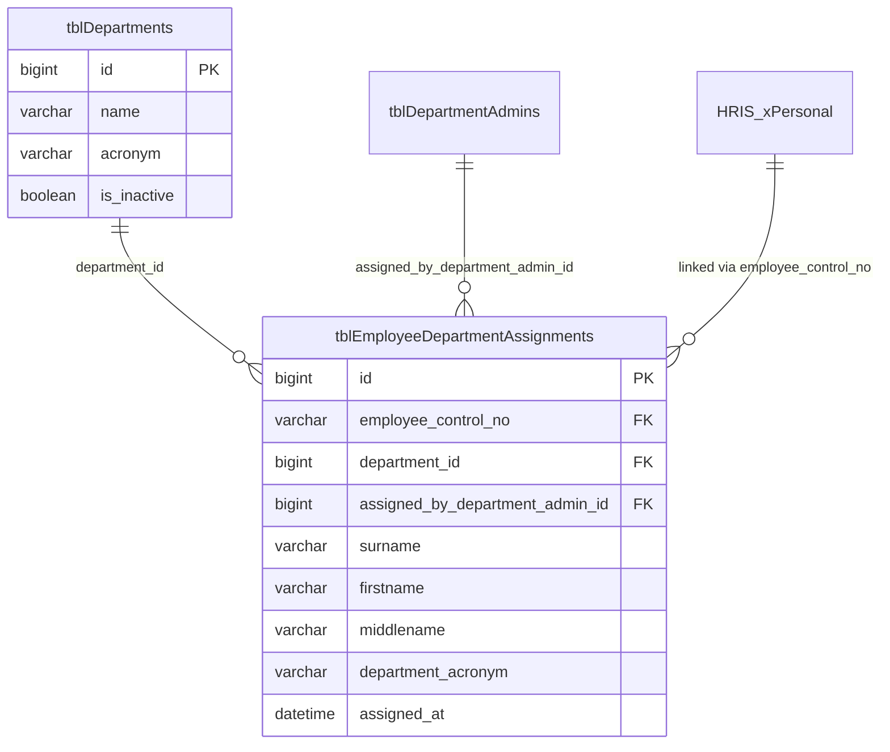

# Employee Management: Department Assignment Backend Structure

This document details the backend structure, database schema, model relationships, and business logic for the **Employee Department Assignment** module in the LMS Backend.

---

## 1. Key Backend Files to Inspect

To study this module directly in the codebase, review the following primary files:

### 1. `app/Models/EmployeeDepartmentAssignment.php`
- **Role:** Primary Eloquent Model for assignments.
- **Short Description:** Represents the `tblEmployeeDepartmentAssignments` table. Defines the mass-assignable fields, relationships (`department`, `assignedBy`), and the critical `booted()` model event hooks that automatically trigger `HrisEmployee::flushCache()` on save and delete so the employee directory stays in sync.

### 2. `app/Models/HrisEmployee.php`
- **Role:** Central Employee Directory & Runtime Override Engine.
- **Short Description:** Slices and queries read-only employee records from the external HRIS SQL Server database (`xPersonal`, `vwpartitionforseparated`, `yOffice`). Contains `loadAssignedDepartmentNames()`, which intercepts raw employee records in memory and dynamically overrides their default HRIS `office` with their assigned department from `tblEmployeeDepartmentAssignments`. Also manages multi-tier caching.

### 3. `app/Http/Controllers/EmployeeController.php`
- **Role:** Core Employee Controller & Request Handler.
- **Short Description:** Orchestrates employee queries and reassignment workflows. Contains `assignEmployeeToDepartment()` (which validates active status, enforces the single-active-department rule, and persists assignments) and `serializeEmployee()` (which formats the unified employee JSON response returned to clients).

### 4. `app/Models/Department.php`
- **Role:** Target Department Model.
- **Short Description:** Represents operating departments (`tblDepartments`). Defines department attributes (`name`, `acronym`) and the `is_inactive` flag used by the assignment engine to ensure assignments to deactivated departments are automatically ignored.

### 5. `app/Models/DepartmentAdmin.php`
- **Role:** Department Administrator Model.
- **Short Description:** Represents administrator accounts authorized to manage a specific department. Foreign-keyed in the assignment table via `assigned_by_department_admin_id` to record which administrator initiated the employee assignment.

### 6. `database/migrations/2026_04_20_000028_reorder_employee_department_assignments_columns.php`
- **Role:** Definitive Schema Migration.
- **Short Description:** The latest migration file for `tblEmployeeDepartmentAssignments`. Defines the official database schema, column sequence, data types, nullability, and structure.

### 7. `routes/api.php`
- **Role:** API Route Registry.
- **Short Description:** Defines the HTTP route endpoints exposed for employee directory browsing, department listings, and department assignment actions (such as `/api/employees`, `/api/departments`, and related admin endpoints).

---

## 2. Overview & Architectural Role

In the LMS backend, raw personnel records originate from an external HRIS database (`xPersonal`, `vwpartitionforseparated`, `yOffice`) accessed as read-only.

Each employee in HRIS has a base plantilla office (`office`). In government operations, employees are frequently assigned, detailed, or "pulled" to perform duties in a different operating department.

The **`tblEmployeeDepartmentAssignments`** table provides the local operational assignment layer:
- Records the reassignment of an employee from their default HRIS office to a local department.
- When an assignment exists, the backend dynamically resolves the employee's operational office (`office`) to the assigned department while preserving the original HRIS plantilla office (`hris_office`).
- Establishes the department-level boundary for permissions, roster visibility, signatory workflows, and leave management.

---

## 3. Database Schema: `tblEmployeeDepartmentAssignments`

The table is located in the primary application database.

### Table Schema Definition

| Column Name | Data Type | Nullable | Description |
| :--- | :--- | :--- | :--- |
| `id` | `BIGINT` / `INT` | No | Primary Key, Auto-increment. |
| `employee_control_no` | `VARCHAR(64)` | No | Canonical HRIS Employee Control Number (`ControlNo`). Canonical string key across modules. |
| `surname` | `VARCHAR(255)` | Yes | Cached snapshot of employee surname. |
| `firstname` | `VARCHAR(255)` | Yes | Cached snapshot of employee firstname. |
| `middlename` | `VARCHAR(255)` | Yes | Cached snapshot of employee middlename. |
| `department_acronym` | `VARCHAR(255)` | Yes | Office acronym snapshot (e.g., `CHRMO`, `CPDO`, `CMO`). |
| `department_id` | `BIGINT` / `INT` | No | Foreign Key referencing `tblDepartments.id`. |
| `assigned_by_department_admin_id`| `BIGINT` / `INT` | Yes | Foreign Key referencing `tblDepartmentAdmins.id`. |
| `assigned_at` | `DATETIME` | Yes | Timestamp when the assignment took effect. |
| `created_at` | `TIMESTAMP` | Yes | Record creation timestamp. |
| `updated_at` | `TIMESTAMP` | Yes | Record update timestamp. |

---

## 4. Entity Relationships



- **`department_id` $\rightarrow$ `tblDepartments.id`**: Connects the employee to the target department. If the department has `is_inactive = true`, the assignment is treated as inactive.
- **`assigned_by_department_admin_id` $\rightarrow$ `tblDepartmentAdmins.id`**: Identifies the administrator account that initiated the assignment.
- **`employee_control_no`**: Corresponds to `ControlNo` in the HRIS directory.

---

## 5. Eloquent Model (`EmployeeDepartmentAssignment`)

File: `app/Models/EmployeeDepartmentAssignment.php`

```php
namespace App\Models;

use Illuminate\Database\Eloquent\Model;
use Illuminate\Database\Eloquent\Relations\BelongsTo;

class EmployeeDepartmentAssignment extends Model
{
    protected $table = 'tblEmployeeDepartmentAssignments';

    protected $fillable = [
        'employee_control_no',
        'department_id',
        'assigned_by_department_admin_id',
        'assigned_at',
        'surname',
        'firstname',
        'middlename',
        'department_acronym',
    ];

    protected function casts(): array
    {
        return [
            'assigned_at' => 'datetime',
        ];
    }

    protected static function booted(): void
    {
        static::saved(static function (): void {
            HrisEmployee::flushCache();
        });

        static::deleted(static function (): void {
            HrisEmployee::flushCache();
        });
    }

    public function department(): BelongsTo
    {
        return $this->belongsTo(Department::class, 'department_id');
    }

    public function assignedBy(): BelongsTo
    {
        return $this->belongsTo(DepartmentAdmin::class, 'assigned_by_department_admin_id');
    }
}
```

---

## 6. Backend Logic & Resolution Rules

### 1. Single Active Department Constraint
- An employee can only belong to **one active department** at a time.
- If an employee is already assigned to an active department, subsequent reassignment attempts to a different department are blocked with HTTP `422`:
  ```json
  {
      "message": "Employee is already pulled by another office in LMS.",
      "assigned_department_name": "City Planning and Development Office"
  }
  ```

### 2. Runtime Office Override (`HrisEmployee`)
When employee records are loaded by the backend (`HrisEmployee::query()` or `HrisEmployee::findByControlNo()`):
1. Active assignments are loaded from `tblEmployeeDepartmentAssignments` with active `tblDepartments`.
2. For any employee matching an active assignment:
   - `office`: Evaluates to `assignment.department.name`.
   - `office_acronym`: Evaluates to the assigned department's acronym.
   - `is_department_reassigned`: `true`.
   - `hris_office`: Retains the raw plantilla office from HRIS.
   - `assigned_department_id`: Assigned department ID.
   - `assigned_department_name`: Assigned department name.
3. For employees without an assignment:
   - `office`: Uses the raw HRIS office.
   - `is_department_reassigned`: `false`.
   - `assigned_department_id`: `null`.
   - `assigned_department_name`: `null`.

### 3. Cache Synchronization
- `HrisEmployee` caches employee datasets and directory lookups to optimize response times.
- On `saved` or `deleted` events in `EmployeeDepartmentAssignment`, `HrisEmployee::flushCache()` is automatically executed to purge the stale employee cache and re-index department assignments.

---

## 7. Controller Implementation

File: `app/Http/Controllers/EmployeeController.php`

### Endpoints Managing Assignments

| Action | Method & Route | Controller Method | Payload / Params |
| :--- | :--- | :--- | :--- |
| **Assign / Pull Employee** | `POST /api/employees` | `EmployeeController@store` | `{ "control_no": "100452" }` |
| **Release / Unassign Employee** | `POST /api/employees/{controlNo}/delete` | `EmployeeController@destroy` | URI param `controlNo` |
| **List Employees by Department** | `GET /api/employees` | `EmployeeController@index` | `?department_id=4&activity=ACTIVE` |

### Assignment Creation / Update (`assignEmployeeToDepartment`)
1. **Verification**: Validates that the target `controlNo` exists and is active in HRIS records.
2. **Conflict Checking**:
   - If the employee is already assigned to the requesting admin's department, the identity snapshot fields are refreshed and HTTP `200` is returned.
   - If the employee is assigned to a different active department, returns HTTP `422`.
   - If the previous assignment's department is inactive, reclaims and reassigns the record.
3. **Persistence**: Saves or updates `tblEmployeeDepartmentAssignments` with the administrator's ID and current timestamp (`assigned_at = now()`).
4. **Serialization Output**: Returns the employee object with the resolved department fields:
   ```json
   {
       "control_no": "100452",
       "full_name": "DELA CRUZ, JUAN M.",
       "office": "City Human Resource Management Office",
       "office_acronym": "CHRMO",
       "hris_office": "City Mayor's Office",
       "is_department_reassigned": true,
       "assigned_department_id": 4,
       "assigned_department_name": "City Human Resource Management Office",
       "status": "Regular"
   }
   ```
